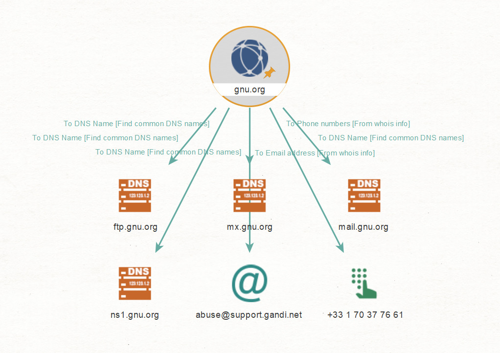
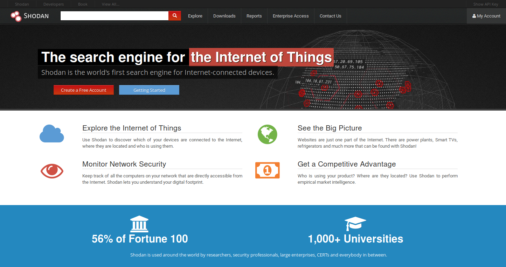
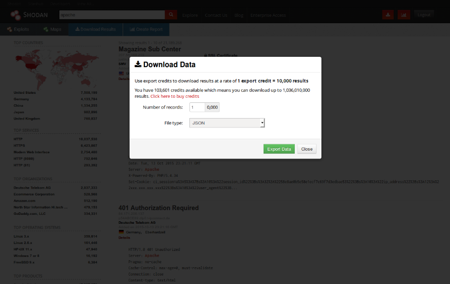
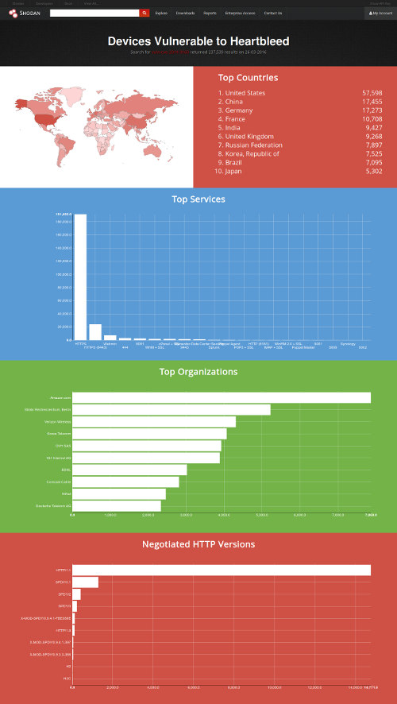
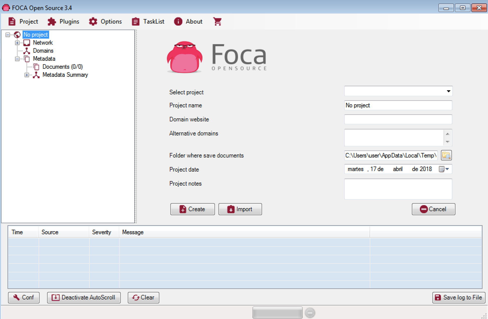
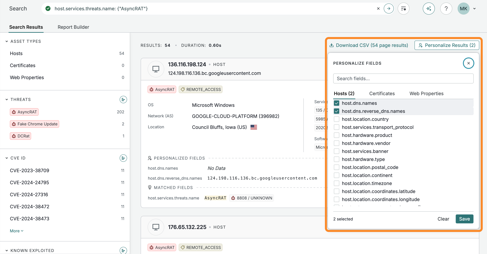
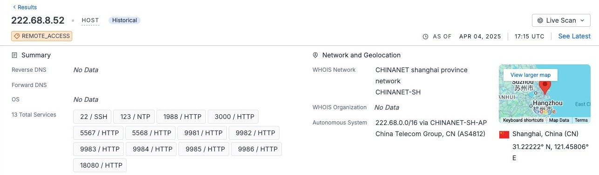

# Herramientas OSINT para infraestructura

[Volver al tema](README.md#herramientas-disponibles-y-criterios-de-elección) · [Definiciones de este tema](definiciones.md)

Un dominio, una IP, una entrada de certificado y un servicio observado responden a preguntas diferentes. La elección de herramienta depende del dato necesario, de su fecha y de cómo se obtiene.

Este catálogo amplía las herramientas de la explicación principal. Las consultas se realizan en el ejercicio final del caso, después de interpretar las muestras.

## Herramientas por función

- [Maltego: mapear relaciones de infraestructura](#maltego-mapear-relaciones-de-infraestructura)
- [SpiderFoot: automatizar obtención mediante módulos](#spiderfoot-automatizar-obtención-mediante-módulos)
- [OWASP Amass: descubrir y relacionar activos](#owasp-amass-descubrir-y-relacionar-activos)
- [Shodan: consultar observaciones de servicios](#shodan-consultar-observaciones-de-servicios)
- [FOCA: extraer metadatos de los documentos publicados](#foca-extraer-metadatos-de-los-documentos-publicados)
- [Censys: consultar hosts, sitios y certificados](#censys-consultar-hosts-sitios-y-certificados)
- [ICANN Lookup, DNS y crt.sh: resolver preguntas acotadas](#icann-lookup-dns-y-crtsh-resolver-preguntas-acotadas)
- [Wappalyzer y DevTools: reconocer señales de tecnología](#wappalyzer-y-devtools-reconocer-señales-de-tecnología)
- [SecurityTrails: comparar DNS actual e histórico](#securitytrails-comparar-dns-actual-e-histórico)
- [urlscan.io: leer observaciones archivadas de páginas web](#urlscanio-leer-observaciones-archivadas-de-páginas-web)
- [VirusTotal: interpretar informes y relaciones de dominios](#virustotal-interpretar-informes-y-relaciones-de-dominios)
- [Elegir por la pregunta](#elegir-por-la-pregunta)

## Maltego: mapear relaciones de infraestructura

Maltego permite representar dominios, nombres DNS, direcciones y otras entidades en un grafo. Las transformaciones consultan fuentes para ampliar una relación; también se puede trabajar con datos aportados. El [tutorial de infraestructura del fabricante](https://www.maltego.com/blog/how-to-use-maltego-transforms-to-map-network-infrastructure-an-in-depth-guide/) muestra ese uso.



Fuente: Maltego, [*Charting My First Maltego Graph*](https://www.maltego.com/blog/beginners-guide-to-maltego-charting-my-first-maltego-graph/), 12 de marzo de 2024. Ejemplo externo a Operación Delta.

En la captura, un dominio se relaciona con varios nombres. La forma del grafo no demuestra propiedad común: se debe revisar qué fuente produjo cada enlace. Para comprender paleta, entidad y menú de transformaciones, consulta el [apartado de Maltego del Tema 3](../03-osint-personas-y-organizaciones/herramientas.md#maltego-relacionar-entidades-y-fuentes).

En Delta permite reunir DEL-D03 → DEL-D04 y separar `tienda-ajena.example`, aunque comparta IP. Antes de ampliar el mapa se revisan los datos que recibiría el proveedor de la transformación y si la consulta contacta con el objetivo. Una transformación no hereda autorización por aparecer en el menú.

**Cuándo encaja:** cuando interesa comparar relaciones y procedencias. **Límite:** el mapa organiza evidencias, no sustituye la validación del activo.

[Volver a la explicación del Tema 4](README.md#herramientas-disponibles-y-criterios-de-elección) · [Índice del catálogo](#herramientas-por-función)

## SpiderFoot: automatizar obtención mediante módulos

SpiderFoot automatiza consultas y relaciona resultados procedentes de módulos. Un módulo define qué fuente utiliza, qué datos necesita y qué eventos puede producir. El [repositorio oficial del proyecto](https://github.com/smicallef/spiderfoot) describe la herramienta y sus opciones.

Su utilidad está en ejecutar de forma repetible un conjunto de consultas. Su riesgo metodológico es recoger demasiado, mezclar fuentes o realizar acciones que el alcance no permite. La palabra «OSINT» no garantiza que todos los módulos sean pasivos.

| Antes de ejecutar | Por qué importa |
|---|---|
| Tipo y valor de la entrada | Un dominio no es lo mismo que una organización o una IP |
| Módulos elegidos | Determinan qué se consulta realmente |
| API y fuentes utilizadas | Condicionan cobertura y datos enviados |
| Contacto con el objetivo | Distingue obtención por terceros de interacción directa |
| Límite de ampliación | Evita incorporar proveedores y terceros al encargo |

En Delta sería candidato si hubiera muchos nombres que contrastar con fuentes autorizadas. Para un único certificado puede resultar innecesario. No se ejecuta una configuración general sobre el dominio ficticio: primero se explica qué módulos responderían a la pregunta y cuáles quedarían excluidos. La instalación y sintaxis se comprueban en la versión disponible, sin asumir que una guía antigua sigue vigente.

[Volver a la explicación del Tema 4](README.md#herramientas-disponibles-y-criterios-de-elección) · [Índice del catálogo](#herramientas-por-función)

## OWASP Amass: descubrir y relacionar activos

[OWASP Amass](https://github.com/owasp-amass/amass) se orienta al descubrimiento de activos y al mapa de superficie externa. Puede ayudar a reunir nombres y relaciones a partir de distintas fuentes. Se diferencia de un índice de servicios: su propósito es construir y ampliar un inventario, no solo mostrar una ficha ya recogida.

Hay que comprobar en la versión utilizada qué operaciones realizan las opciones elegidas. El alcance, las fuentes y las posibles interacciones se fijan antes de ejecutar. No se proporcionan comandos tomados de versiones anteriores como si fueran actuales.

En Delta encajaría para una revisión más amplia de nombres, si la empresa la autorizara. Para interpretar DEL-C02 basta con CT; no hace falta ampliar a un reconocimiento general. Esta comparación se trabaja en [Elección de herramientas](casos/operacion-delta/02-eleccion-de-herramientas.md).

[Volver a la explicación del Tema 4](README.md#herramientas-disponibles-y-criterios-de-elección) · [Índice del catálogo](#herramientas-por-función)

## Shodan: consultar observaciones de servicios

### Cómo funciona

[Shodan](https://www.shodan.io/) es un buscador de servicios conectados a Internet. Sus sistemas recorren de forma continua las direcciones IP públicas, se conectan a los puertos abiertos y guardan lo que responde cada servicio. Cada respuesta guardada es un **banner**, que contiene:

- la dirección IP y el puerto;
- la fecha de la observación;
- la organización que tiene asignado el rango de direcciones;
- la ubicación aproximada;
- el texto que devolvió el servicio: cabeceras web, nombre y versión del programa, certificado o mensaje de bienvenida.

Una búsqueda sin filtros busca el texto en el contenido del banner. Para buscar por IP, dominio, organización o puerto se usan filtros.

Cuando consultas Shodan, lees observaciones que ya están hechas: tu consulta llega a Shodan, no a la organización. Por eso es una técnica pasiva. Deja de serlo con estas acciones, excluidas de las prácticas:

| Acción excluida | Por qué deja de ser pasiva |
|---|---|
| Pedir un escaneo nuevo (*scan on demand*) | Shodan se conecta otra vez a los sistemas por encargo tuyo |
| Abrir en el navegador o en otro programa una IP o un puerto encontrados | Te conectas tú al servicio de la organización |
| Abrir Shodan Images o capturas de cámaras y escritorios remotos | Accedes a contenido que nadie ha decidido publicar |
| Comprobar si una vulnerabilidad listada es real | Es una prueba sobre un sistema ajeno |

### Cuenta y acceso

- Sin iniciar sesión, la búsqueda es muy limitada.
- Con una **cuenta gratuita** se usan los filtros de esta ficha y se ven las primeras páginas de resultados. Es suficiente para las prácticas.
- La descarga de resultados, Shodan Images, el filtro de vulnerabilidades y los escaneos bajo demanda son de pago y no se utilizan.

Si la cuenta no permite algo, se anota como una restricción. Una restricción no es un resultado vacío.

### La interfaz



Fuente: [documentación de Shodan](https://help.shodan.io/the-basics/navigating-the-website). La interfaz actual tiene otro diseño, pero conserva los mismos elementos.

La consulta se escribe en la caja superior. La cuenta se abre desde el botón de la esquina derecha.



Fuente: [documentación de Shodan](https://help.shodan.io/the-basics/navigating-the-website). Búsqueda de ejemplo, ajena a las prácticas.

Detrás del cuadro de descarga está la página de resultados. A la izquierda aparecen las **facetas**, que resumen todos los resultados por país, servicio, organización, sistema operativo y producto. A la derecha, cada resultado muestra su IP, su organización y el principio del banner. Las facetas se leen **antes** de abrir resultados sueltos: dicen, por ejemplo, si la mayoría pertenece a un proveedor de alojamiento y no a la organización.



Fuente: [documentación de Shodan](https://help.shodan.io/the-basics/navigating-the-website). El ejemplo trata de una vulnerabilidad de 2014 y solo muestra el formato.

El botón de informe convierte una consulta en gráficos por país, servicio y organización. Para describir una organización, una distribución de este tipo es más útil que una lista de direcciones. En un informe público se presentan cifras agregadas, no fichas de equipos concretos.

### Filtros útiles para una organización

Un filtro se escribe `nombre:valor`, sin espacio. Si el valor tiene espacios, va entre comillas: `org:"Nombre de la Entidad"`. Para combinar filtros se escriben seguidos: `hostname:DOMINIO port:443`.

| Consulta | Qué devuelve | Precaución |
|---|---|---|
| `ip:DIRECCIÓN` | La ficha de una IP concreta, con todos sus puertos | Muestra la última observación de cada puerto, no el estado actual |
| `hostname:DOMINIO` | Banners con un nombre de host que contiene el dominio | Incluye subdominios y nombres parecidos de otras entidades |
| `ssl:"DOMINIO"` | Servicios cuyo certificado menciona el dominio | El certificado puede estar en un proveedor compartido o en una red de distribución de contenidos (CDN) |
| `ssl.cert.subject.cn:DOMINIO` | Certificados emitidos exactamente para ese nombre | Más preciso que `ssl:`; deja fuera certificados emitidos para varios nombres |
| `org:"NOMBRE"` | Banners de rangos de IP asignados a ese nombre | El titular del rango suele ser el proveedor de alojamiento, no su cliente |
| `net:RANGO` | Banners de un rango concreto | Solo si otra fuente fiable demuestra que el rango es de la organización |
| `port:443`, `country:ES` | Acotar por puerto o país | Se añaden a otra consulta, no se usan solos |

Los marcadores en mayúsculas se sustituyen por los datos del objetivo. Se empieza por la consulta más acotada y se amplía de una en una, para saber qué cambia cada filtro.

### Cómo leer una ficha

Al pulsar en un resultado se abre la ficha de la IP, con todos sus puertos y banners.

| Campo | Qué permite afirmar | Qué no demuestra |
|---|---|---|
| IP y nombres de host | Esos nombres estaban asociados a la IP en la observación | Que la organización controle el equipo |
| Organización e ISP | Quién tiene asignado el rango | Quién usa el servicio |
| Puerto y banner | Qué respondió el servicio en esa fecha | Que siga respondiendo hoy |
| Producto y versión | Lo que el servicio declaró de sí mismo | La versión real: el banner se puede modificar |
| Certificado | Para qué nombres se emitió | Que todos esos nombres estén en uso |
| Fecha de la observación | Cuándo se recogió el dato | El estado actual |
| Vulnerabilidades, si aparecen | Que la versión declarada figura en un catálogo de fallos | Que el fallo exista o se pueda aprovechar |

Cada resultado se clasifica en uno de tres grupos:

- **de la organización**, cuando otra fuente lo respalda, como su web, sus certificados o su DNS;
- **de un proveedor**: alojamiento, nube, CDN o correo;
- **relación no demostrada**, que queda como pendiente.

En Delta ayuda a interpretar DEL-S04. Consultar datos existentes no equivale a solicitar un escaneo nuevo: esta última acción queda fuera del encargo.

### Procedimiento

1. Parte del dominio y del nombre legal ya validados con fuentes corporativas.
2. Inicia sesión con tu cuenta de investigación.
3. Ejecuta `hostname:DOMINIO`. Después, `ssl:` u `org:` si la pregunta lo necesita. Anota cada consulta exacta, la fecha y el número de resultados.
4. Lee las facetas.
5. Abre solo las fichas que la pregunta necesita. Anota puerto, producto declarado, fecha de observación y titular del rango.
6. Clasifica cada resultado en uno de los tres grupos y contrasta los que atribuyas a la organización.
7. Si aparece un servicio delicado, como un escritorio remoto, una cámara, un panel de control industrial o una base de datos, no lo abras ni captures su contenido, y avisa por el canal privado de la asignatura.

**Para qué sirve:** describir qué parte de la organización está expuesta a Internet y qué depende de proveedores. **Para qué no sirve:** demostrar quién es el propietario de un activo, la versión real de un servicio o que un fallo exista.

[Volver a la explicación del Tema 4](README.md#herramientas-disponibles-y-criterios-de-elección) · [Índice del catálogo](#herramientas-por-función)

## FOCA: extraer metadatos de los documentos publicados

### Cómo funciona

**FOCA** (*Fingerprinting Organizations with Collected Archives*) es una herramienta gratuita y de código abierto creada por ElevenPaths, de Telefónica. Trabaja en tres pasos:

1. **Busca** en Google, Bing y DuckDuckGo los documentos publicados en un dominio, con consultas del tipo `site:DOMINIO filetype:pdf`.
2. **Descarga** los documentos encontrados, como lo haría cualquier visitante de la web.
3. **Extrae los metadatos** de cada documento y los agrupa por categorías para toda la organización.

También analiza documentos que ya tienes en tu equipo.

Los **metadatos** son datos sobre el documento que el programa añade al crearlo o guardarlo y que no se ven al leerlo: autor, organización, fechas de creación y modificación, programa y versión, plantilla, ruta en la que se guardó o impresora. Un documento aislado dice poco. Cientos de documentos de una misma organización permiten reconstruir su **huella documental**.

| Metadato | Qué revela de la organización | Cómo podría aprovecharlo un atacante | Medida defensiva |
|---|---|---|---|
| Autor o usuario | El formato de los nombres de usuario internos | Hacer creíble un mensaje o deducir el formato de las cuentas | Limpiar los metadatos antes de publicar |
| Ruta local o de red | Nombres de servidores, unidades compartidas y carpetas | Dar apariencia interna a un engaño | Exportar desde una ubicación neutra o limpiar las rutas |
| Programa y versión | Qué software de ofimática se usa y si está actualizado | Preparar un archivo adjunto dirigido | Actualizar el software y limpiar los metadatos |
| Impresora | Nombres de equipos internos | Ampliar el mapa del entorno interno | Limpiar los metadatos |
| Correo | Direcciones de contacto o personales | Suplantación o mensajes dirigidos | Usar buzones genéricos en los documentos públicos |
| Fechas | Antigüedad y ritmo de publicación | Detectar documentos antiguos que nadie revisa | Revisar y retirar lo obsoleto |

### Instalación

FOCA funciona en **Windows de 64 bits** y necesita:

- Microsoft .NET Framework 4.7.1;
- Microsoft Visual C++ 2010 x64 o posterior;
- SQL Server 2014 o posterior. La edición gratuita **SQL Server Express** es suficiente.

Pasos:

1. Instala SQL Server Express con la instancia por defecto, `SQLEXPRESS`.
2. Descarga `FOCA-v3.4.7.1.zip` desde la [página de versiones del repositorio](https://github.com/ElevenPaths/FOCA/releases). Es la última versión, de agosto de 2021.
3. Descomprímelo en una carpeta de trabajo y ejecuta `FOCA.exe`.
4. Al arrancar, FOCA busca la instancia de SQL Server. Si no la encuentra, pide una cadena de conexión: `Data Source=.\SQLEXPRESS;Integrated Security=True`.

En macOS o Linux se usa una máquina virtual con Windows o un equipo del aula.

FOCA no recibe actualizaciones desde 2022, y los buscadores pueden bloquear sus consultas o devolver pocos resultados. En ese caso se aplica el [procedimiento alternativo](#procedimiento-alternativo-análisis-local).

### La interfaz



Fuente: Alumbra456, [Wikimedia Commons](https://commons.wikimedia.org/wiki/File:FOCAInterfazPrincipal.png), 2018, licencia [CC BY-SA 4.0](https://creativecommons.org/licenses/by-sa/4.0/deed.es). FOCA Open Source 3.4, sin modificar.

| Zona | Contenido | Uso en las prácticas |
|---|---|---|
| Árbol de la izquierda | `Network`, `Domains` y `Metadata`, con `Documents` y `Metadata Summary` | Solo se trabaja en `Metadata` |
| Panel derecho | Formulario del proyecto: nombre, dominio, dominios alternativos, carpeta de descarga, fecha y notas | Se rellena al crear el proyecto |
| Panel inferior | Registro de actividad: hora, origen, gravedad y mensaje | `Save log to File` lo guarda para la bitácora |

`Network` y `Domains` se rellenan solos con los servidores y dominios que aparecen en las URL y en los metadatos. Desde esos nodos, y desde `Plugins`, FOCA lanza búsquedas DNS, rastreos y pruebas contra los servidores de la organización. Eso es reconocimiento activo y queda fuera de las prácticas. Lo que aparezca en esos nodos se trata como un dato de los documentos, no como una comprobación.

### Procedimiento

1. **Proyecto.** En `Project > New project`, escribe un nombre, el dominio principal de la organización y, solo si son suyos, los dominios alternativos. La carpeta de descarga debe estar fuera del repositorio. En las notas, escribe la pregunta y el alcance. Pulsa `Create`.
2. **Búsqueda.** Selecciona `Metadata > Documents`. Marca los buscadores y las extensiones que respondan a la pregunta, por ejemplo `pdf`, `docx`, `xlsx`, `pptx` y `odt`, y pulsa `Search All`. Anota cuántos documentos aparecen y de qué tipo.
3. **Selección.** No descargues todo. Elige un número limitado de documentos, de tipos y fechas variados, y descárgalos con el botón derecho, `Download`.
4. **Extracción.** Con el botón derecho, ejecuta `Extract Metadata` y después `Analyze Metadata`.
5. **Resumen.** Abre `Metadata Summary`: `Users`, `Folders`, `Printers`, `Software`, `Emails`, `Operating Systems` y `Servers`. Anota cuántos elementos hay en cada categoría y qué patrones se repiten.
6. **Detalle.** Abre algunos documentos para comprobar fechas, programa y autor. Distingue el programa que creó el documento del que lo convirtió a PDF.
7. **Cierre.** Guarda el registro con `Save log to File`. Al terminar, borra los documentos descargados y el proyecto.

### Procedimiento alternativo: análisis local

Si la búsqueda de FOCA falla, localiza los documentos con Google, con `site:DOMINIO filetype:pdf`, y descárgalos desde la web pública. En FOCA, añádelos a `Documents` con el botón derecho (`Add file` o `Add folder`) o arrastrándolos a la lista, y sigue desde el paso 4.

Si no puedes ejecutar FOCA, usa [ExifTool](https://exiftool.org/): extrae los mismos metadatos documento a documento, aunque sin el resumen por categorías. Registra el cambio.

### Interpretar los resultados

| Observación | Lectura correcta |
|---|---|
| Un autor aparece en muchos documentos | Puede ser el autor de la plantilla, no de cada documento |
| El programa es una herramienta de conversión a PDF | Describe la conversión, no el equipo en el que se escribió |
| Una ruta contiene un nombre de usuario | Es un dato personal: se seudonimiza y no se investiga a esa persona |
| El documento está en el dominio de la organización | Puede haberlo elaborado un tercero, como un proveedor o un organismo |
| No aparecen metadatos | La organización los limpia, o el documento se generó sin ellos |
| Las fechas son antiguas | El documento sigue publicado; no dice nada del software actual |

Los nombres, usuarios y correos de los metadatos son **datos personales**. En una entrega se presentan agregados o con seudónimos (`USR-01`, `USR-02`…). Se describe el patrón, como «formato nombre.apellido», sin publicar los valores. Un metadato no autoriza a investigar a la persona que generó el documento.

**Para qué sirve:** valorar qué revela una organización, sin querer, a través de los documentos que publica. **Para qué no sirve:** describir su infraestructura actual o identificar a quién pertenece una cuenta. **Licencia:** gratuita, [GPL-3.0](https://www.gnu.org/licenses/gpl-3.0.html).

[Volver a la explicación del Tema 4](README.md#herramientas-disponibles-y-criterios-de-elección) · [Índice del catálogo](#herramientas-por-función)

## Censys: consultar hosts, sitios y certificados

Censys permite consultar conjuntos de datos de hosts, propiedades web y certificados. Se selecciona el conjunto adecuado para la pregunta. La [guía de inicio](https://docs.censys.com/docs/platform-quickstart-guide) explica esas diferencias.



Fuente: Censys, [*Quick Start Guide*](https://docs.censys.com/docs/platform-quickstart-guide). La captura ilustra consulta, resultado y selección de campos. Su búsqueda de ejemplo y sus IP no forman parte del caso ni se ejecutan como práctica.

Lee la consulta en la parte superior, el tipo de activo y los campos mostrados. Un contador representa resultados del conjunto consultado, no activos propios confirmados.



Fuente: Censys, [misma guía](https://docs.censys.com/docs/platform-quickstart-guide). Resumen de un host del ejemplo documental; no describe a Dársena.

Para comparar con otro índice hay que conservar la fecha de la observación, protocolo y forma de asociación con el nombre. Que dos fichas compartan IP no garantiza que describan la misma aplicación.

Censys Platform utiliza [CenQL](https://docs.censys.com/docs/censys-query-language). Ejemplos de consulta:

```text
host.ip=IP_OBSERVADA
host.ip=IP_OBSERVADA and host.services.port=443
host.ip=IP_OBSERVADA and host.services: (port=443 and protocol=HTTP)
```

La agrupación obliga a que las condiciones correspondan al mismo servicio. Sin ella, varios campos pueden coincidir en servicios distintos del host. La sintaxis de Legacy Search es diferente.

En Delta permite comparar DEL-S01 y DEL-S06 por procedencia y fecha. El acceso o una exportación real facilitada en clase determina qué se puede consultar; no se exige contratar un plan.

[Volver a la explicación del Tema 4](README.md#herramientas-disponibles-y-criterios-de-elección) · [Índice del catálogo](#herramientas-por-función)

## ICANN Lookup, DNS y crt.sh: resolver preguntas acotadas

| Recurso | Qué aporta | Qué no acredita |
|---|---|---|
| [ICANN Lookup](https://lookup.icann.org/en) | Datos de registro RDAP | Autoría del contenido o de una actividad |
| [Resolve-DnsName](https://learn.microsoft.com/en-us/powershell/module/dnsclient/resolve-dnsname) o dig | Respuesta DNS en una consulta | Propiedad de todos los servicios de la IP |
| [crt.sh: respuesta de ejemplo](https://crt.sh/?q=www.example.org&output=json) | Entradas CT y nombres de certificados | Servicio activo ni despliegue del certificado |

Un recurso sencillo puede ser la mejor elección para una pregunta concreta. Registro, DNS y CT se interpretan en el [Tema 4](README.md#whois-dns-y-certificados) antes de ejecutar las consultas del caso.

Para DNS se conservan nombre, tipo, valor, TTL y hora. Para CT se conserva entrada, certificado, nombres y fechas. La búsqueda de un nombre bajo el dominio puede plantearse con `%.DOMINIO_AUTORIZADO` en crt.sh. Las entradas repetidas no se cuentan como activos distintos.

El enlace de ejemplo devuelve JSON para `www.example.org`. Permite leer campos como `id`, `name_value`, `not_before`, `not_after` y `serial_number` sin depender de la página de inicio. La fecha de incorporación al registro se conserva si el detalle la facilita; no se sustituye por el inicio de validez del certificado. La interfaz web ofrece otra presentación de los datos; si limita consultas, se registra la limitación o se utiliza una salida fechada ya aportada.

[Volver a la explicación del Tema 4](README.md#herramientas-disponibles-y-criterios-de-elección) · [Índice del catálogo](#herramientas-por-función)

## Wappalyzer y DevTools: reconocer señales de tecnología

[Wappalyzer](https://www.wappalyzer.com/apps/) infiere tecnologías a partir de señales. Las herramientas de desarrollo del navegador permiten leer directamente peticiones, cabeceras y respuesta HTML; la [guía de DevTools](https://developer.chrome.com/docs/devtools/network/) muestra dónde se encuentran esos datos.

La detección se contrasta con una señal concreta: cabecera, nombre de cookie, elemento HTML o ruta. Un intermediario puede cambiar las cabeceras y una aplicación puede imitar una señal. Detectar un producto no confirma versión, configuración ni vulnerabilidad.

En Delta se empieza con DEL-H01, sin abrir el servicio ficticio. Más adelante se examina una web propia o expresamente autorizada. Abrir la web contacta con el servicio; no es lectura de un índice pasivo.

[Volver a la explicación del Tema 4](README.md#herramientas-disponibles-y-criterios-de-elección) · [Índice del catálogo](#herramientas-por-función)

## SecurityTrails: comparar DNS actual e histórico

[SecurityTrails](https://docs.securitytrails.com/docs/overview) permite consultar datos de dominios, DNS, IP y registro. Su valor para OSINT es comparar relaciones observadas en distintos momentos, cuando una respuesta DNS actual no basta para entender un cambio.

| Dato que interesa | Qué aporta | Reserva |
|---|---|---|
| Registros DNS | Destinos asociados a nombres | Hay que conservar tipo y fecha |
| Histórico de un registro | Cambios observados por la fuente | No cubre necesariamente todos los cambios |
| Subdominios conocidos | Candidatos para contrastar con inventario | Aparición no equivale a servicio actual |
| Relación con una IP | Contexto del alojamiento | La IP puede ser compartida o reutilizada |

Procedimiento: consulta el dominio autorizado, selecciona el tipo de registro y compara observaciones fechadas. Anota qué cambio sostiene el histórico y contrástalo con inventario o certificado. Si hay varias IP, no presupongas una migración completa sin más datos. La cobertura, el histórico visible y la API dependen del acceso; no se incluye una clave en el registro del estudiante.

En Delta encaja para la pregunta «¿qué destino tuvo legado antes de su retirada?». DEL-D ya proporciona una muestra ficticia: se interpreta sin intentar obtener datos de `darsena.example`. Compara esta herramienta con DNS actual en [Elección](casos/operacion-delta/02-eleccion-de-herramientas.md) y registra el uso sobre un objetivo real en [Históricos y páginas archivadas](casos/operacion-delta/04-obtencion-con-herramientas.md#históricos-y-páginas-archivadas).

[Volver a la explicación del Tema 4](README.md#herramientas-disponibles-y-criterios-de-elección) · [Índice del catálogo](#herramientas-por-función)

## urlscan.io: leer observaciones archivadas de páginas web

[urlscan.io](https://urlscan.io/docs/search/) permite buscar resultados de visitas realizadas por su servicio. Una ficha puede mostrar la página, solicitudes de red y destinos contactados. **Buscar una ficha existente** y **enviar una URL para que se visite** son operaciones distintas. En el caso se consultan resultados ya publicados; no se solicita una visita nueva.

### Campos para acotar

| Campo | Ejemplo con marcador | Qué busca |
|---|---|---|
| `page.domain` | `page.domain:DOMINIO_AUTORIZADO` | Dominio de la página observada |
| `page.ip` | `page.ip:IP_AUTORIZADA` | IP de la página |
| `domain` | `domain:DOMINIO_AUTORIZADO` | Dominio contactado durante la visita, que puede ser un recurso externo |
| `date` | `page.domain:DOMINIO_AUTORIZADO AND date:>now-30d` | Resultados del periodo |

Los marcadores se sustituyen por referencias autorizadas. La [referencia de campos](https://urlscan.io/docs/search/) permite comprobar las diferencias: un dominio de analítica contactado no es el dominio de la página principal.

Para leer una ficha, conserva identificador y fecha, revisa URL inicial y destino tras las redirecciones y distingue servidor principal de recursos externos. Una captura demuestra lo que vio ese servicio en ese momento. No representa todos los usuarios ni acredita que el contenido siga publicado.

En Delta ayuda a interpretar una página histórica como DEL-S03 y las señales de DEL-H01. Se aplica en [Históricos y páginas archivadas](casos/operacion-delta/04-obtencion-con-herramientas.md#históricos-y-páginas-archivadas). Una URL con tokens o datos internos no se envía a un servicio público.

[Volver a la explicación del Tema 4](README.md#herramientas-disponibles-y-criterios-de-elección) · [Índice del catálogo](#herramientas-por-función)

## VirusTotal: interpretar informes y relaciones de dominios

[VirusTotal](https://docs.virustotal.com/docs/searching) reúne informes y relaciones sobre archivos, URL, dominios e IP. La [referencia de dominios](https://docs.virustotal.com/reference/domains-object) describe datos como registro, resoluciones y certificados. Algunas funciones pertenecen a servicios de pago.

| Elemento del informe | Lectura adecuada | Lectura que se evita |
|---|---|---|
| Detecciones de proveedores | Opiniones o resultados registrados, con su fecha | «Un contador demuestra un delito» |
| Resoluciones DNS | Relaciones observadas entre nombre e IP | «Todas las direcciones pertenecen al mismo titular» |
| Certificados | Información vinculada al dominio | «El certificado garantiza que la web es segura» |
| Archivos relacionados | Relación descrita por el informe | «Todo archivo relacionado fue publicado por la organización» |

Antes de consultar hay que revisar qué acción provoca la interfaz. La guía de búsqueda advierte de que los indicadores consultados o enviados por la web pueden ser analizados e incorporados al conjunto de datos. Por tanto, no se presenta cualquier búsqueda web como pasiva ni se envían indicadores internos o personales.

Para este caso se puede interpretar un informe ya facilitado en clase, con referencia y fecha, o consultar un indicador público cuando el alcance permita ese procesamiento. Se registra procedencia, relación y límite; no se solicita un nuevo análisis de un objetivo ajeno ni se descargan muestras de malware.

En Delta encaja para comparar relaciones y reputación como contexto, sin convertir DEL-S04 en una intrusión. La configuración y el modo de consulta se justifican en [Elección de herramientas](casos/operacion-delta/02-eleccion-de-herramientas.md); las evidencias se conservan en [Obtención](casos/operacion-delta/04-obtencion-con-herramientas.md#contrastar-un-informe-de-reputación).

[Volver a la explicación del Tema 4](README.md#herramientas-disponibles-y-criterios-de-elección) · [Índice del catálogo](#herramientas-por-función)

## Elegir por la pregunta

| Pregunta | Primera opción posible | Cuándo ampliar |
|---|---|---|
| ¿Qué consta en el registro? | RDAP | Si hace falta otra fuente de titularidad o uso |
| ¿A qué destino se asocia el nombre? | DNS | Si se necesita un histórico |
| ¿Cómo cambió el destino observado? | SecurityTrails | Si hay que contrastar otro histórico |
| ¿Qué página y recursos vio un servicio? | urlscan.io, resultado existente | Si hay que comparar otra fecha |
| ¿Qué relaciones y reputación constan en un informe? | VirusTotal | Si el alcance permite el modo de consulta |
| ¿Qué nombres aparecen en certificados? | CT | Si se debe contrastar inventario |
| ¿Qué servicio observó un tercero? | Shodan o Censys | Si interesa comparar cobertura y fecha |
| ¿Qué revelan los documentos publicados? | FOCA | Si hace falta revisar documentos uno a uno con ExifTool |
| ¿Cómo represento las relaciones? | Maltego | Si el grafo ayuda a interpretar el conjunto |
| ¿Cómo automatizo una obtención amplia? | SpiderFoot o Amass | Solo con alcance y configuración revisados |

Los [créditos de las capturas](../../imagenes/03-04-capturas.md) identifican publicación e imagen de origen. La elección razonada precede a la ejecución.

[Volver a la explicación del Tema 4](README.md#herramientas-disponibles-y-criterios-de-elección) · [Índice del catálogo](#herramientas-por-función)
