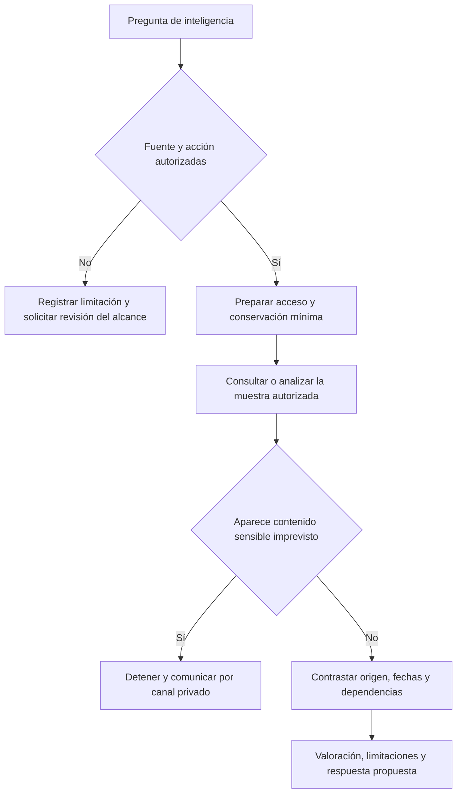

# Fuentes cerradas y dark web

[Índice de la asignatura](../../README.md) · [Definiciones de este tema](definiciones.md)

## Organización del tema

Esta página contiene la explicación principal. Los cinco ejercicios de **Operación Umbral** se abren en los puntos indicados y se resuelven en archivos separados. Cada ejercicio incluye un enlace para regresar al apartado siguiente. El [catálogo de herramientas](herramientas.md) y las [referencias](recursos.md) amplían las explicaciones; no es necesario recorrerlos completos para continuar la lectura.

1. [Objeto de estudio y alcance](#objeto-de-estudio-y-alcance)
2. [Surface web, deep web y dark web: diferencias](#surface-web-deep-web-y-dark-web-diferencias)
3. [Acceso seguro y búsqueda de credenciales filtradas](#acceso-seguro-y-búsqueda-de-credenciales-filtradas)
4. [Riesgos legales y operacionales específicos](#riesgos-legales-y-operacionales-específicos)
5. [Método de análisis y valoración](#método-de-análisis-y-valoración)
6. [Casos documentados y práctica de contraste](#casos-documentados-y-práctica-de-contraste)
7. [Aplicación al proyecto individual](#aplicación-al-proyecto-individual)
8. [Continuación](#continuación)

## Objeto de estudio y alcance

Una organización recibe una alerta: alguien afirma vender miles de cuentas recientes. El aviso puede proceder de un proveedor contratado, una noticia o una publicación reproducida por varias cuentas. Antes de hablar de una intrusión nueva deben resolverse varias preguntas: qué fuente se ha consultado, de dónde procede la afirmación, qué fechas describe, qué datos contiene y qué puede comprobarse sin obtener información robada.

El análisis de fuentes cerradas estudia información cuyo acceso tiene condiciones: una cuenta autorizada, una licencia, una suscripción, un acuerdo de confidencialidad o un procedimiento de verificación. La dark web describe un entorno de acceso, no una garantía de calidad ni una categoría de información necesariamente delictiva. Ambos conceptos se relacionan en algunas investigaciones, pero no son equivalentes.

El objetivo de este tema es **valorar fuentes y alertas de exposición, documentar sus límites y proponer una respuesta proporcionada**. No se requiere entrar en mercados, descargar filtraciones ni comprobar si funciona una contraseña. La búsqueda de credenciales filtradas prevista en la guía docente se aborda como una actividad defensiva de detección y valoración mediante servicios legítimos, referencias públicas y resultados simulados. No autoriza a recopilar o utilizar las credenciales.

El caso [Operación Umbral](casos/operacion-umbral/README.md#situación) plantea una alerta sobre **Nácar Servicios**, una entidad ficticia. Todos sus registros están preparados para docencia. Las cuentas se representan mediante identificadores y no se incluyen correos, contraseñas ni tokens reales. Los dominios `.example` del expediente no se consultan.

## Surface web, deep web y dark web: diferencias

### Indexación, acceso y permisos

Un buscador no contiene toda la web. Algunas páginas no se indexan, otras se generan después de una consulta y muchas requieren autenticación. Que una página no aparezca en Google no demuestra que esté oculta deliberadamente ni que pertenezca a la dark web.

| Concepto | Característica principal | Ejemplo | Conclusión que debe evitarse |
|---|---|---|---|
| Surface web o web superficial | Contenido que puede localizarse mediante índices de buscadores convencionales | Comunicado público de una entidad | Que toda página indexada puede copiarse y reutilizarse sin límites |
| Deep web o web profunda | Contenido no accesible mediante esos índices, por su forma de publicación o sus controles de acceso | Buzón personal, intranet o consulta privada en una base de datos | Que todo contenido no indexado es clandestino |
| Dark web o web oscura | Servicios que utilizan redes y mecanismos de acceso específicos, como los servicios onion de Tor | Servicio de publicación o comunicación accesible mediante Tor | Que usar Tor demuestra actividad delictiva o legitima lo que se consulta |
| Fuente cerrada | Información cuyo acceso o uso está sujeto a condiciones | Portal de inteligencia con licencia o informe interno facilitado para un encargo | Que pagar o disponer de una cuenta permite redistribuir todos sus datos |

Estas categorías no deben interpretarse como compartimentos exactos ni como porcentajes fijos de Internet. Una misma entidad puede publicar un comunicado abierto, mantener un portal privado y ofrecer un servicio onion. También pueden circular copias de un mismo contenido por distintos medios.

La pregunta práctica tiene tres partes: **cómo se encuentra**, **cómo se accede** y **qué está permitido hacer con la información**. Una noticia pública que describe un mercado clandestino es una fuente abierta sobre ese mercado; no equivale a haber accedido al mercado ni a disponer de sus registros originales.

### Fuentes cerradas y valor analítico

Una fuente cerrada puede aportar contexto que no está en las noticias: fecha de detección, clasificación de una muestra o relación entre registros. Su utilidad depende de la procedencia, cobertura, método de obtención y condiciones de uso. Una presentación comercial o el número de registros anunciado no sustituyen esa evaluación.

| Aspecto | Pregunta para la evaluación |
|---|---|
| Procedencia | ¿Es una observación directa, una copia, un aviso de tercero o una inferencia del proveedor? |
| Cobertura | ¿Qué entornos y periodos observa? ¿Qué queda fuera? |
| Fechas | ¿Se conoce la fecha del incidente, la publicación, la captura y la incorporación al servicio? |
| Independencia | ¿Dos proveedores obtuvieron el dato por separado o dependen del mismo origen? |
| Condiciones | ¿Se permite consultar, exportar, conservar y compartir el resultado? ¿Con quién? |
| Contenido necesario | ¿Puede responderse con un resumen o se está solicitando información sensible innecesaria? |

El permiso de acceso y el permiso de difusión son distintos. Puede autorizarse la lectura de un informe sin permitir su publicación en el repositorio del curso. Una exportación autorizada no convierte en publicables los nombres o secretos que contenga.

**Práctica 1:** [Umbral · Clasificación de fuentes y permisos](casos/operacion-umbral/01-fuentes-y-permisos.md). Al terminar, regresa a [Acceso seguro y búsqueda de credenciales filtradas](#acceso-seguro-y-búsqueda-de-credenciales-filtradas).

## Acceso seguro y búsqueda de credenciales filtradas

### Preparación del acceso

El acceso comienza con una decisión documentada, no con la instalación de una herramienta. Deben constar el objetivo, las fuentes admitidas, las acciones permitidas, la información que puede conservarse y las condiciones de parada. Las normas del curso y del encargo pueden ser más restrictivas que las posibilidades técnicas del servicio.

La **seguridad operacional u OPSEC** reúne las medidas para proteger la investigación y a sus participantes. En este ámbito importa tanto lo que se descarga como lo que una consulta revela sobre quien la realiza. El proveedor puede conocer la cuenta utilizada, la consulta, el momento y la red de origen.

Antes del acceso se establece un entorno de trabajo separado, actualizado y adecuado al material, con almacenamiento y destinatarios definidos. No se reutilizan cuentas personales para investigar objetivos ajenos ni se crean identidades falsas para eludir restricciones. Una máquina virtual ayuda a separar tareas, pero no garantiza anonimato ni permite abrir archivos sospechosos sin un procedimiento específico.

### Tor y servicios onion

**Tor** es una red que distribuye las conexiones entre varios nodos. **Tor Browser** es un navegador preparado para utilizarla y reducir determinadas formas de seguimiento. En la navegación hacia una web convencional, el circuito suele incluir un nodo de entrada, uno intermedio y uno de salida. La web observa la conexión desde la salida de Tor, no una conexión directa desde el equipo. La [introducción oficial a Tor Browser](https://support.torproject.org/tor-browser/getting-started/about-tor-browser/) explica este funcionamiento.

Un **servicio onion** se alcanza dentro de Tor y utiliza una dirección `.onion`. Su conexión no funciona igual que la salida hacia una web convencional: no utiliza un nodo de salida para llegar al servicio. El [glosario de Tor](https://support.torproject.org/glossary/) distingue ambos recorridos. Abrir una web normal en Tor Browser no transforma esa web en un servicio de la dark web.

La dirección onion identifica criptográficamente un servicio, pero no demuestra que quien lo opera sea la organización que afirma representar ni que sus publicaciones sean verdaderas. La dirección debe obtenerse de una referencia institucional o de otro canal previamente verificado, no de un directorio anónimo o de una oferta recibida. Véase la [explicación oficial de servicios onion](https://support.torproject.org/tor-browser/features/onion-services/).

### Protecciones y limitaciones de Tor Browser

| Medida | Qué aporta | Qué no resuelve |
|---|---|---|
| Uso de Tor Browser obtenido desde su distribución oficial | Navegador preparado para la red Tor | No legitima la fuente ni sustituye la autorización |
| Separación entre cuentas y sesiones de trabajo | Reduce mezclas de identidad y contenido | Un inicio de sesión puede identificar a la persona ante el servicio |
| Revisión del nivel de seguridad | Puede limitar funciones y scripts de las páginas | Una página que deja de funcionar no justifica reducir protecciones sin revisar el plan |
| Uso adecuado de HTTPS en webs convencionales | Protege el tramo hasta la web cuando se utiliza correctamente | No convierte el contenido en fiable ni evita que el sitio registre lo recibido |
| Conservación mínima y entorno separado | Reduce la exposición de datos y archivos | No elimina todos los riesgos del equipo o de los documentos |

Tor protege las aplicaciones configuradas para utilizarlo, no automáticamente todo el tráfico del ordenador. Los documentos abiertos en aplicaciones externas pueden iniciar conexiones fuera de ese recorrido. También pueden identificarse usuarios por los datos que entregan voluntariamente. Estas limitaciones se recogen en las [recomendaciones de uso de Tor Browser](https://support.torproject.org/tor-browser/security/using-tb-safely/).

Los niveles **Standard**, **Safer** y **Safest** modifican las funciones disponibles en las páginas. Se elige el nivel según el procedimiento de trabajo y se registra cualquier cambio; no son tres grados de autorización. La [documentación de niveles de seguridad](https://support.torproject.org/tor-browser/features/security-levels/) explica sus diferencias.

Tor tampoco ofrece anonimato absoluto frente a un observador capaz de correlacionar tráfico en varios puntos. Una VPN no corrige por sí sola esa limitación ni valida la identidad de una fuente. La [documentación sobre ataques restantes](https://support.torproject.org/about-tor/security/attacks-on-onion-routing/) describe el problema de correlación. La elección de una red o navegador debe responder al riesgo y a la autorización, no a una promesa general de invisibilidad.

En estas prácticas se utiliza documentación pública y el expediente local. El catálogo incluye una demostración opcional limitada a servicios oficiales; no requiere entrar en mercados ni consultar enlaces de una filtración.

**Práctica 2:** [Umbral · Plan de acceso y seguridad operacional](casos/operacion-umbral/02-acceso-y-opsec.md). Al terminar, regresa a [Búsqueda defensiva de exposición de credenciales](#búsqueda-defensiva-de-exposición-de-credenciales).

### Búsqueda defensiva de exposición de credenciales

El objetivo defensivo es saber qué cuentas o servicios requieren revisión, no obtener contraseñas. La evidencia útil puede ser una notificación legítima, una referencia de exposición, las categorías de datos afectadas o un informe autorizado del responsable del servicio. No es necesario poseer el secreto para justificar una revisión.

| Información | Significado | Limitación |
|---|---|---|
| Dirección de correo en una notificación | Relaciona un identificador con el incidente descrito por la fuente | No demuestra que la contraseña actual se conozca o que se haya accedido a otras cuentas |
| Contraseña o hash mencionado en una alerta | Señala una categoría de dato potencialmente expuesta | No se copia ni se prueba; puede ser histórica, falsa o no corresponder al acceso actual |
| Cookie o token de sesión | Puede representar una sesión ya establecida | Cambiar una contraseña no debe darse por equivalente a invalidar todas las sesiones |
| Clave de API o secreto de una aplicación | Puede dar acceso a una función técnica | Deben identificarse responsable y alcance, sin utilizar el secreto |
| Registro de un infostealer | Puede incluir información recogida de un equipo, como sesiones o datos de autenticación | No acredita por sí solo el estado actual de cada cuenta o la extensión del compromiso |

Una **cookie** es un dato que una web almacena y recupera del navegador; no todas son de autenticación. Un **token de sesión** permite representar una sesión o autorización. Un **infostealer** es un programa malicioso diseñado para sustraer información. Estas distinciones explican por qué una alerta sobre sesiones puede requerir revisar dispositivos, permisos y revocación, además de contraseñas.

Una contraseña en texto claro y un hash de contraseña no representan la misma exposición. El hash no es un cifrado reversible con una clave; su resistencia depende del método y de sus parámetros. Conocer la presencia de hashes no permite afirmar que se hayan recuperado las contraseñas ni descartar el riesgo. La [guía de almacenamiento de contraseñas de OWASP](https://cheatsheetseries.owasp.org/cheatsheets/Password_Storage_Cheat_Sheet.html) explica esa diferencia.

La **autenticación multifactor (MFA)** comprueba factores distintos para verificar un acceso. Una sesión posterior puede mantenerse mediante su propio secreto, por lo que no se debe afirmar que activar MFA o cambiar una contraseña resuelve por sí solo cualquier sustracción de sesión. Debe revisarse el mecanismo concreto de invalidación y renovación. Las referencias de [gestión de sesiones de NIST](https://pages.nist.gov/800-63-4/sp800-63b/session/) y [OWASP](https://cheatsheetseries.owasp.org/cheatsheets/Session_Management_Cheat_Sheet.html) permiten contrastar esta separación.

Los informes sobre **Genesis Market** muestran la comercialización conjunta de datos de acceso y huellas de navegador. La [Policía de Países Bajos](https://www.politie.nl/en/news/2023/april/5/operation-cookiemonster.html) describe la operación de retirada del mercado en abril de 2023. Ese contexto orienta las preguntas sobre sesiones, pero no acredita que una organización concreta esté afectada.

### Consultas legítimas y resultados negativos

La información debe obtenerse por un medio admitido: notificación del proveedor, servicio legítimo con las verificaciones exigidas, exportación autorizada o informe público. No se realizan búsquedas de contraseñas de compañeros, empleados o clientes, ni se abren muestras ofrecidas por vendedores.

**Have I Been Pwned (HIBP)** ofrece funciones diferentes para referencias de brechas y para contraseñas. La consulta de una dirección no devuelve su contraseña. Algunas funciones requieren verificación del control del dominio o de la cuenta. La [FAQ de HIBP](https://haveibeenpwned.com/FAQs) explica la separación entre sus servicios y las limitaciones de consulta.

Un resultado negativo significa que no se ha encontrado una coincidencia en la consulta y cobertura disponibles. No demuestra que nunca existiera exposición. Un error de autenticación, la falta de una licencia o una función no contratada tampoco equivalen a un resultado negativo.

En la asignatura se estudian resultados preparados y documentación pública. Cualquier uso posterior sobre cuentas propias o dominios autorizados debe estar previsto en el alcance y cumplir las condiciones del servicio. No se introducen credenciales reales en una demostración ni se descargan colecciones para ampliar la búsqueda.

### Consulta por prefijo de hash

Un **hash** es una huella calculada sobre un dato. En esta consulta se utiliza el algoritmo SHA-1 para obtener una huella que se divide en dos partes; no se envía el dato original. El procedimiento se conoce como consulta por rango o modelo de **k-anonimato**: se pide un conjunto de resultados que comparten prefijo, en lugar de identificar directamente el valor completo.

**Pwned Passwords** permite comprobar coincidencias mediante un modelo de consulta por prefijo: se calcula localmente SHA-1, se envían los primeros cinco caracteres y se compara el resto con los sufijos devueltos. El servicio no recibe así la contraseña completa ni su hash completo en esa consulta. La [explicación de Pwned Passwords](https://haveibeenpwned.com/Passwords) describe el modelo; la [API oficial](https://haveibeenpwned.com/api/v3#PwnedPasswords) documenta su uso.

El resultado indica una coincidencia en ese conjunto, no que una cuenta concreta esté comprometida. La consulta no vincula por sí sola el valor con una persona. SHA-1 se utiliza aquí para dividir la búsqueda de un protocolo existente; no se recomienda como mecanismo de almacenamiento de contraseñas. Tampoco se confunde con las huellas SHA-256 y MD5 utilizadas para identificar archivos de evidencia.

La práctica incluye una demostración **local, sin red**, con un valor de prueba conocido y una respuesta simulada. No sirve para comprobar contraseñas reales ni consulta HIBP. Su finalidad es interpretar el prefijo, el sufijo y el resultado sin enviar secretos a ningún servicio.

### Fechas, duplicados y alcance de una coincidencia

Una fecha reciente puede corresponder a la incorporación de un dato antiguo. Deben separarse al menos la fecha del incidente, la publicación, la observación del proveedor y la consulta propia. Si una fecha no consta, se anota esa limitación; no se sustituye por otra.

| Situación | Interpretación adecuada |
|---|---|
| Dos proveedores repiten un registro con el mismo origen | Dos observaciones no equivalen a dos incidentes ni a confirmación independiente |
| El aviso contiene una cuenta actualmente activa | Justifica revisión según el dato y el contexto; no demuestra que su secreto siga siendo válido |
| Una cuenta histórica está deshabilitada | Reduce una vía concreta de acceso, pero no descarta reutilización, sesiones u otros datos expuestos |
| El vendedor anuncia miles de cuentas | Es una afirmación del vendedor hasta contar con respaldo; una muestra pequeña no valida el volumen |
| No se identifica una cuenta en el inventario | Puede faltar cobertura o existir un error de asociación; no se atribuye a otra persona para completar la lista |

**Práctica 3:** [Umbral · Contraste de la alerta y consulta por prefijo](casos/operacion-umbral/03-alerta-y-credenciales.md). Al terminar, regresa a [Riesgos legales y operacionales específicos](#riesgos-legales-y-operacionales-específicos).

## Riesgos legales y operacionales específicos

### Autorización y tratamiento de datos

El acceso técnico, la autorización del encargo, las condiciones de la fuente y el tratamiento de datos deben revisarse por separado. Un proveedor puede autorizar una consulta y restringir la exportación. Una cuenta legítima no permite consultar personas ajenas al encargo. La autorización académica tampoco sustituye los permisos del titular de un sistema.

En España, el [Código Penal](https://www.boe.es/buscar/act.php?id=BOE-A-1995-25444) regula, entre otras conductas, el descubrimiento y revelación de secretos y el acceso no autorizado a sistemas. Los artículos 197, 197 bis y 197 ter requieren atender a sus elementos concretos; no toda situación tiene la misma calificación. En la práctica, probar una credencial o eludir una restricción no se convierte en una acción permitida por alegar finalidad docente.

El **Reglamento General de Protección de Datos (RGPD)** exige justificar el tratamiento y aplicar principios como finalidad, minimización y limitación de conservación. Que un dato se haya difundido sin permiso no elimina su protección. Los [artículos 5 y 6 del RGPD](https://eur-lex.europa.eu/eli/reg/2016/679/oj?locale=es) son referencias para esta evaluación. La [Ley Orgánica 3/2018](https://www.boe.es/buscar/act.php?id=BOE-A-2018-16673) completa el marco español. No se presume una base jurídica por el mero interés del investigador.

En una investigación profesional deben definirse responsable, finalidad, personas autorizadas, conservación y condiciones del proveedor, incluidos los flujos de datos que puedan requerir revisión. Los casos de este tema utilizan datos de prueba para que el razonamiento no dependa de tratar información personal real.

### Riesgos del acceso y del contenido

| Riesgo | Cómo puede aparecer | Decisión de trabajo |
|---|---|---|
| Suplantación de la fuente | Copia de un portal o dirección recibida sin verificar | Contrastar su procedencia antes de acceder |
| Identificación de la investigación | Reutilización de cuenta, consultas o archivos que revelan el objetivo | Mantener el entorno y las consultas dentro del plan de OPSEC |
| Contenido malicioso | Archivo, documento activo o enlace presentado como muestra | No descargar ni abrir; detener la acción y utilizar el canal previsto |
| Obtención excesiva | Exportación completa de personas ajenas al encargo | Solicitar un resumen o una exportación mínima autorizada |
| Pérdida de control de la difusión | Captura con nombres o secretos publicada para justificar una conclusión | Conservar solo lo necesario y separar el informe de la evidencia reservada |
| Engaño o información preparada | Datos antiguos vendidos como nuevos o resultados fabricados | Contrastar fechas, origen y coherencia; mantener la atribución de la afirmación |
| Sesgo de confirmación | Interpretar cualquier coincidencia como prueba de la hipótesis inicial | Comparar explicaciones alternativas y buscar información que pueda refutarla |

Se detiene el trabajo si una fuente exige pagar al presunto vendedor, contactar con él, entregar una cuenta personal, abrir una muestra o utilizar un secreto. En el entorno profesional esas situaciones requieren competencias y autorizaciones distintas; no forman parte de estas prácticas. Se comunica el hallazgo por el canal privado previsto, sin reenviar el contenido sensible.

### Conservación y respuesta a una posible brecha

El registro mínimo conserva la pregunta, la referencia, las fechas, el tipo de dato, las condiciones de acceso, la decisión y la limitación. No incluye la contraseña, cookie o token. Si se conserva un archivo permitido, se anotan SHA-256 y MD5 de la misma versión; las dos huellas permiten comparaciones y no acreditan su veracidad ni sustituyen la custodia. MD5 no debe utilizarse como garantía criptográfica de seguridad; sus limitaciones se describen en el [RFC 6151](https://www.rfc-editor.org/rfc/rfc6151).

Una alerta puede requerir elevar el caso al equipo de respuesta y al responsable de protección de datos antes de completar el análisis. La decisión sobre una brecha no corresponde al estudiante ni se resuelve publicando una captura. El artículo 33 del RGPD contempla la notificación sin dilación indebida y, de ser posible, en 72 horas desde la constancia, salvo que sea improbable el riesgo; el artículo 34 regula la comunicación a las personas cuando sea probable un alto riesgo, con sus excepciones. La [orientación de la AEPD](https://www.aepd.es/derechos-y-deberes/cumple-tus-deberes/medidas-de-cumplimiento/brechas-de-datos-personales-notificacion) ayuda a distinguir ambas decisiones.

No se confunde la recepción de un rumor con una constatación suficiente ni se retrasa una actuación necesaria hasta terminar el informe. Deben documentarse el conocimiento disponible, la evaluación y las actualizaciones. Tampoco se presenta el plazo de 72 horas como un periodo concedido para esperar sin actuar.

**Práctica 4:** [Umbral · Riesgos, conservación y comunicación](casos/operacion-umbral/04-riesgos-y-comunicacion.md). Al terminar, regresa a [Método de análisis y valoración](#método-de-análisis-y-valoración).

## Método de análisis y valoración

La fuente acredita primero lo que publica o registra. Su afirmación debe atribuirse a quien la emite hasta disponer de contraste. Que un intermediario diga haber visto una muestra puede justificar una comprobación interna, pero no convierte esa muestra en evidencia examinada por el analista.

| Paso | Pregunta | Resultado esperado |
|---|---|---|
| Formular el encargo | ¿Qué decisión necesita información? | Preguntas delimitadas y destinatario |
| Revisar el acceso | ¿Fuente y acción están autorizadas? | Procedimiento y condiciones de parada |
| Obtener lo necesario | ¿Qué referencia mínima responde a la pregunta? | Evidencia permitida con fecha y procedencia |
| Contrastar | ¿Hay independencia, actualidad y relación con el objetivo? | Hallazgos y explicaciones alternativas |
| Valorar | ¿Qué puede sostenerse y con qué confianza? | Conclusiones proporcionadas y limitaciones |
| Proponer respuesta | ¿Qué revisión o protección justifica la evidencia? | Prioridad, responsable propuesto y dato pendiente |

En una alerta histórica, la prioridad puede ser revisar exposición y reutilización sin afirmar una intrusión actual. En una alerta sobre un posible token de sesión reciente, puede justificarse una revisión urgente de sesiones y dispositivos aunque no se haya probado su validez. La urgencia depende de la consecuencia plausible y del respaldo disponible; no exige convertir una hipótesis en certeza.

Las recomendaciones distinguen quién analiza, quién autoriza y quién ejecuta las medidas. Cambiar secretos, revocar sesiones, revisar registros y comprobar dispositivos son acciones del equipo responsable dentro de su procedimiento, no pruebas que el estudiante deba realizar para demostrar el hallazgo.

## Casos documentados y práctica de contraste

Dos referencias públicas permiten aplicar este método sin acceder a sus datos sustraídos:

- **Genesis Market y la operación de abril de 2023.** Permite estudiar la relación entre datos de autenticación, sesiones y huellas de navegador, y distinguir el comunicado de una autoridad de una observación propia del mercado. [Comunicado de la Policía de Países Bajos](https://www.politie.nl/en/news/2023/april/5/operation-cookiemonster.html).
- **Collection #1, descrita en enero de 2019.** Permite diferenciar filas, combinaciones y direcciones únicas en una colección de orígenes diversos. Esas unidades no se transforman automáticamente en personas o incidentes nuevos. [Análisis original de Troy Hunt](https://www.troyhunt.com/the-773-million-record-collection-1-data-reach/).

El [contraste documental de casos reales](casos/casos-reales.md) utiliza solo esas explicaciones públicas y señala qué partes consultar. No requiere abrir enlaces a muestras, listas o archivos de los incidentes.

**Práctica 5:** [Umbral · Valoración final y contraste de casos](casos/operacion-umbral/05-valoracion-final.md). Al terminar, regresa a [Aplicación al proyecto individual](#aplicación-al-proyecto-individual).

## Aplicación al proyecto individual

La aplicación del tema no obliga a obtener una filtración. Puede consistir en evaluar un aviso, justificar por qué no se utiliza una fuente, documentar límites de verificación o proponer una revisión por el responsable adecuado.

| Proyecto | Aplicación posible |
|---|---|
| Investigación sobre uno mismo | Analizar un aviso legítimo recibido y la documentación del proveedor, sin publicar datos personales ni comprobar contraseñas |
| Web o dominio propio | Valorar un aviso autorizado del alojamiento o de exposición, distinguiendo dominio, cuenta, secreto y sesión |
| Incidente documentado de una organización | Comparar comunicados e informes públicos y atribuir las afirmaciones sobre filtración a sus emisores |
| Revisión de proveedores | Evaluar procedencia, licencia, cobertura y condiciones de una fuente antes de incorporarla al método |

Las fechas, el canal de entrega, la evaluación y las condiciones de uso de IA se rigen por el enunciado del curso. Estos ejercicios son material de aprendizaje y no crean una actividad evaluable nueva.

## Continuación

El [registro de práctica](casos/operacion-umbral/registro-practica.md) reúne las decisiones del caso. Los términos están en [Definiciones](definiciones.md), los procedimientos de consulta en [Herramientas](herramientas.md) y las fuentes de referencia en [Recursos](recursos.md).

El siguiente tema desarrolla la [inteligencia de amenazas y MITRE ATT&CK](../06-threat-intelligence-y-mitre-attck/README.md): cómo relacionar indicadores, comportamientos y fuentes sin atribuir un actor o una técnica por una sola coincidencia.
