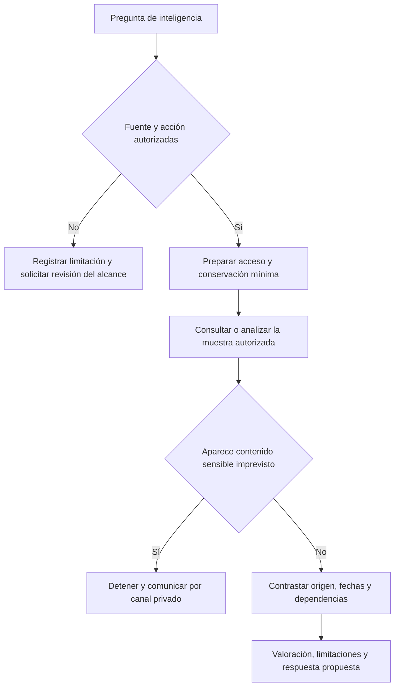

# Fuentes cerradas y dark web

[Índice de la asignatura](../../README.md) · [Definiciones de este tema](definiciones.md)

## Organización del tema

Esta página contiene la explicación principal. Los cinco ejercicios de **Operación Umbral** se abren en los puntos indicados y se resuelven en archivos separados. Cada ejercicio incluye un enlace para regresar al apartado siguiente. El [catálogo de herramientas](herramientas.md) y las [referencias](recursos.md) amplían las explicaciones; no es necesario recorrerlos completos para continuar la lectura.

1. [Objeto de estudio y alcance](#objeto-de-estudio-y-alcance)
2. [Surface web, deep web y dark web: diferencias](#surface-web-deep-web-y-dark-web-diferencias)
3. [Acceso seguro, Tor y seguridad operacional](#acceso-seguro-y-búsqueda-de-credenciales-filtradas)
4. [Qué hay realmente en la dark web y en entornos cerrados](#qué-hay-realmente-en-la-dark-web-y-en-entornos-cerrados)
5. [Monitorización y búsqueda de credenciales filtradas](#monitorización-y-búsqueda-de-credenciales-filtradas)
6. [Riesgos legales, éticos y operacionales específicos](#riesgos-legales-éticos-y-operacionales-específicos)
7. [Casos de referencia y criterio del analista](#casos-de-referencia-y-criterio-del-analista)
8. [Encaje con el proyecto final y continuación](#encaje-con-el-proyecto-final-y-continuación)

## Objeto de estudio y alcance

Una organización recibe una alerta: alguien afirma vender miles de cuentas recientes. El aviso puede proceder de un proveedor contratado, una noticia o una publicación reproducida por varias cuentas. Antes de hablar de una intrusión nueva deben resolverse varias preguntas: qué fuente se ha consultado, de dónde procede la afirmación, qué fechas describe, qué datos contiene y qué puede comprobarse sin obtener información robada.

El análisis de fuentes cerradas estudia información cuyo acceso tiene condiciones: una cuenta autorizada, una licencia, una suscripción, un acuerdo de confidencialidad o un procedimiento de verificación. La dark web describe un entorno de acceso, no una garantía de calidad ni una categoría de información necesariamente delictiva. Ambos conceptos se relacionan en algunas investigaciones, pero no son equivalentes.

El objetivo de este tema es **valorar fuentes y alertas de exposición, documentar sus límites y proponer una respuesta proporcionada**. No se requiere entrar en mercados, descargar filtraciones ni comprobar si funciona una contraseña. La búsqueda de credenciales filtradas prevista en la guía docente se aborda como una actividad defensiva de detección y valoración mediante servicios legítimos, referencias públicas y resultados simulados. No autoriza a recopilar o utilizar las credenciales.

El caso [Operación Umbral](casos/operacion-umbral/README.md#situación) plantea una alerta sobre **Nácar Servicios**, una entidad ficticia. Las cuentas se representan mediante identificadores y no se incluyen correos, contraseñas ni tokens reales. Los dominios `.example` del expediente no se consultan.

## Surface web, deep web y dark web: diferencias

### Indexación, acceso y permisos

Un buscador no contiene toda la web. Algunas páginas no se indexan, otras se generan después de una consulta y muchas requieren autenticación. Que una página no aparezca en Google no demuestra que esté oculta deliberadamente ni que pertenezca a la dark web.

| Concepto | Característica principal | Ejemplo | Conclusión que debe evitarse |
|---|---|---|---|
| Surface web o web superficial | Contenido que puede localizarse mediante índices de buscadores convencionales | Comunicado público de una entidad | Que toda página indexada puede copiarse y reutilizarse sin límites |
| Deep web o web profunda | Contenido no accesible mediante esos índices, por su forma de publicación o sus controles de acceso | Buzón personal, intranet o consulta privada en una base de datos | Que todo contenido no indexado es clandestino |
| Dark web o web oscura | Servicios que utilizan redes y mecanismos de acceso específicos, como los servicios onion de Tor | Servicio de publicación o comunicación accesible mediante Tor | Que usar Tor demuestra actividad delictiva o legitima lo que se consulta |
| Fuente cerrada | Información cuyo acceso o uso está sujeto a condiciones | Portal de inteligencia con licencia o informe interno facilitado para un encargo | Que pagar o disponer de una cuenta permite redistribuir todos sus datos |

Estas categorías no deben interpretarse como compartimentos exactos ni como porcentajes fijos de Internet. Una misma entidad puede publicar un comunicado abierto, mantener un portal privado y ofrecer un servicio onion. También pueden circular copias de un mismo contenido por distintos medios.

La pregunta práctica tiene tres partes: **cómo se encuentra**, **cómo se accede** y **qué está permitido hacer con la información**. Una noticia pública que describe un mercado clandestino es una fuente abierta sobre ese mercado; no equivale a haber accedido al mercado ni a disponer de sus registros originales.

### Fuentes cerradas y valor analítico

Una fuente cerrada puede aportar contexto que no está en las noticias: fecha de detección, clasificación de una muestra o relación entre registros. Su utilidad depende de la procedencia, cobertura, método de obtención y condiciones de uso. Una presentación comercial o el número de registros anunciado no sustituyen esa evaluación.

| Aspecto | Pregunta para la evaluación |
|---|---|
| Procedencia | ¿Es una observación directa, una copia, un aviso de tercero o una inferencia del proveedor? |
| Cobertura | ¿Qué entornos y periodos observa? ¿Qué queda fuera? |
| Fechas | ¿Se conoce la fecha del incidente, la publicación, la captura y la incorporación al servicio? |
| Independencia | ¿Dos proveedores obtuvieron el dato por separado o dependen del mismo origen? |
| Condiciones | ¿Se permite consultar, exportar, conservar y compartir el resultado? ¿Con quién? |
| Contenido necesario | ¿Puede responderse con un resumen o se está solicitando información sensible innecesaria? |

El permiso de acceso y el permiso de difusión son distintos. Puede autorizarse la lectura de un informe sin permitir su publicación en el repositorio del curso. Una exportación autorizada no convierte en publicables los nombres o secretos que contenga.

**Práctica 1:** [Umbral · Clasificación de fuentes y permisos](casos/operacion-umbral/01-fuentes-y-permisos.md). Al terminar, regresa a [Acceso seguro y búsqueda de credenciales filtradas](#acceso-seguro-y-búsqueda-de-credenciales-filtradas).

## Acceso seguro y búsqueda de credenciales filtradas

### Preparación del acceso

El acceso comienza con una decisión documentada, no con la instalación de una herramienta. Deben constar el objetivo, las fuentes admitidas, las acciones permitidas, la información que puede conservarse y las condiciones de parada. Las normas del curso y del encargo pueden ser más restrictivas que las posibilidades técnicas del servicio.

La **seguridad operacional u OPSEC** reúne las medidas para proteger la investigación y a sus participantes. En este ámbito importa tanto lo que se descarga como lo que una consulta revela sobre quien la realiza. El proveedor puede conocer la cuenta utilizada, la consulta, el momento y la red de origen.

Antes del acceso se establece un entorno de trabajo separado, actualizado y adecuado al material, con almacenamiento y destinatarios definidos. No se reutilizan cuentas personales para investigar objetivos ajenos ni se crean identidades falsas para eludir restricciones. Una máquina virtual ayuda a separar tareas, pero no garantiza anonimato ni permite abrir archivos sospechosos sin un procedimiento específico.

### Tor y servicios onion

**Tor** es una red que distribuye las conexiones entre varios nodos. **Tor Browser** es un navegador preparado para utilizarla y reducir determinadas formas de seguimiento. En la navegación hacia una web convencional, el circuito suele incluir un nodo de entrada, uno intermedio y uno de salida. La web observa la conexión desde la salida de Tor, no una conexión directa desde el equipo. La [introducción oficial a Tor Browser](https://support.torproject.org/tor-browser/getting-started/about-tor-browser/) explica este funcionamiento.

Un **servicio onion** se alcanza dentro de Tor y utiliza una dirección `.onion`. Su conexión no funciona igual que la salida hacia una web convencional: no utiliza un nodo de salida para llegar al servicio. El [glosario de Tor](https://support.torproject.org/glossary/) distingue ambos recorridos. Abrir una web normal en Tor Browser no transforma esa web en un servicio de la dark web.

La dirección onion identifica criptográficamente un servicio, pero no demuestra que quien lo opera sea la organización que afirma representar ni que sus publicaciones sean verdaderas. La dirección debe obtenerse de una referencia institucional o de otro canal previamente verificado, no de un directorio anónimo o de una oferta recibida. Véase la [explicación oficial de servicios onion](https://support.torproject.org/tor-browser/features/onion-services/).

### Protecciones y limitaciones de Tor Browser

| Medida | Qué aporta | Qué no resuelve |
|---|---|---|
| Uso de Tor Browser obtenido desde su distribución oficial | Navegador preparado para la red Tor | No legitima la fuente ni sustituye la autorización |
| Separación entre cuentas y sesiones de trabajo | Reduce mezclas de identidad y contenido | Un inicio de sesión puede identificar a la persona ante el servicio |
| Revisión del nivel de seguridad | Puede limitar funciones y scripts de las páginas | Una página que deja de funcionar no justifica reducir protecciones sin revisar el plan |
| Uso adecuado de HTTPS en webs convencionales | Protege el tramo hasta la web cuando se utiliza correctamente | No convierte el contenido en fiable ni evita que el sitio registre lo recibido |
| Conservación mínima y entorno separado | Reduce la exposición de datos y archivos | No elimina todos los riesgos del equipo o de los documentos |

Tor protege las aplicaciones configuradas para utilizarlo, no automáticamente todo el tráfico del ordenador. Los documentos abiertos en aplicaciones externas pueden iniciar conexiones fuera de ese recorrido. También pueden identificarse usuarios por los datos que entregan voluntariamente. Estas limitaciones se recogen en las [recomendaciones de uso de Tor Browser](https://support.torproject.org/tor-browser/security/using-tb-safely/).

Los niveles **Standard**, **Safer** y **Safest** modifican las funciones disponibles en las páginas. Se elige el nivel según el procedimiento de trabajo y se registra cualquier cambio; no son tres grados de autorización. La [documentación de niveles de seguridad](https://support.torproject.org/tor-browser/features/security-levels/) explica sus diferencias.

Tor tampoco ofrece anonimato absoluto frente a un observador capaz de correlacionar tráfico en varios puntos. Una VPN no corrige por sí sola esa limitación ni valida la identidad de una fuente. La [documentación sobre ataques restantes](https://support.torproject.org/about-tor/security/attacks-on-onion-routing/) describe el problema de correlación. La elección de una red o navegador debe responder al riesgo y a la autorización, no a una promesa general de invisibilidad.

**Práctica 2:** [Umbral · Plan de acceso y seguridad operacional](casos/operacion-umbral/02-acceso-y-opsec.md). Al terminar, regresa a [Qué hay realmente en la dark web y en entornos cerrados](#qué-hay-realmente-en-la-dark-web-y-en-entornos-cerrados).

## Qué hay realmente en la dark web y en entornos cerrados

Cuando se habla de la dark web suele aparecer una imagen exagerada: un rincón secreto de Internet donde todo es ilegal. En la práctica el panorama es más mezclado, y entender qué convive dentro ahorra muchos errores de análisis.

### Servicios legítimos y verificación de direcciones `.onion`

En la red Tor existen servicios completamente legales y públicos. Medios de comunicación internacionales como **BBC News** mantienen réplicas `.onion` para que personas en países con censura puedan leer noticias sin bloqueos. Organizaciones periodísticas como **ProPublica** o **The New York Times** operan buzones de **SecureDrop** para recibir filtraciones de fuentes anónimas. También tienen servicio onion buscadores orientados a la privacidad como **DuckDuckGo**, proveedores de correo cifrado como **Proton**, el propio **Proyecto Tor** e incluso portales institucionales.

El problema práctico está en cómo llegar a ellos. Una dirección onion v3 es una cadena de 56 caracteres aparentemente aleatorios. Nadie la recuerda de memoria, y esa dificultad la aprovechan quienes montan copias falsas (*phishing* o clones con enlaces manipulados) en directorios y wikis anónimas. Por eso en ciberinteligencia rige una regla sencilla: una dirección `.onion` no se da por buena porque aparezca en una lista cualquiera. Se verifica primero en la web oficial de la organización (por ejemplo, en `onion.torproject.org` o `proton.me/tor`) o mediante la cabecera `Onion-Location`, que muestra un aviso directo en la barra de direcciones de Tor Browser cuando visitas la web oficial.

### Ecosistema delictivo y canales cerrados

Junto a esos servicios legítimos existe el ecosistema subterráneo que interesa vigilar desde defensa. Tampoco funciona de forma uniforme; cada espacio tiene sus reglas y su utilidad para un analista:

| Entorno | Qué suele circular | Cómo opera habitualmente | Qué tiene en cuenta el analista |
|---|---|---|---|
| **Foros cerrados** | Accesos corporativos (*Initial Access Brokers*), bases de datos robadas, herramientas y ofertas de colaboración | Registro restringido, invitación o fianza; reputación interna, moderación y sistemas de depósito (*escrow*) | Hay competencia y estafas internas; una publicación en un foro es una afirmación, no una prueba |
| **Mercados clandestinos** | Credenciales, tarjetas, sesiones de navegador y documentación robada | Tiendas automatizadas con pago en criptomonedas y vida corta por operaciones policiales o *exit scams* | Las direcciones cambian o se clonan con frecuencia; el inventario anunciado suele estar inflado o reciclado |
| **Sitios de extorsión (*Data Leak Sites*)** | Nombres de víctimas de ransomware, cuentas atrás, pruebas de robo y enlaces de descarga | Blogs en `.onion` gestionados por grupos de ransomware para presionar el pago del rescate | Casi nunca hace falta conectarse al `.onion`: rastreadores públicos y plataformas CTI indexan estos avisos sin exponer tu equipo |
| **Mensajería cifrada y *paste sites*** | Volcados rápidos, logs de *infostealers*, avisos de brechas y reventa de listas | Canales de Telegram que abren y cierran a diario, además de repositorios temporales de texto | Buena parte de la actividad actual ocurre fuera de Tor; los enlaces caducan rápido y se reenvían sin origen claro |

Conviene quedarse con una idea clave: en estos entornos abunda el ruido. Es muy habitual que un vendedor junte filtraciones de hace años y las anuncie como una brecha nueva, que infle el número de cuentas para ganar prestigio o que simplemente estafe a otros compradores. Leer un título llamativo en un foro o un canal nunca basta para dar por hecho un ataque reciente.

## Monitorización y búsqueda de credenciales filtradas

Uno de los trabajos más habituales de ciberinteligencia defensiva es detectar si circulan credenciales o datos internos de una organización. El objetivo es claro: saber qué cuentas, equipos o servicios necesitan revisión cuanto antes, **sin descargar bases de datos robadas y sin probar si una contraseña funciona**.

### De dónde salen las credenciales que aparecen en alertas

No todas las exposiciones tienen el mismo origen ni exigen la misma urgencia. Un analista necesita distinguir tres fuentes habituales:

- **Brechas de terceros:** un servicio externo sufre un robo de base de datos y en él aparecen correos corporativos registrados por empleados. El riesgo principal es que alguien haya reutilizado la misma contraseña en el trabajo (*credential stuffing*). Además, no es lo mismo que se filtren contraseñas en texto claro a que se filtren *hashes* robustos.
- **Combolists y colecciones agregadas:** archivos enormes que mezclan cientos de brechas antiguas (el caso más conocido fue *Collection #1*, en 2019). Se reempaquetan una y otra vez con fechas nuevas, así que generan muchas falsas alarmas si no se comprueba de cuándo procede realmente cada registro.
- **Logs de *infostealers*:** aquí el escenario cambia por completo. Un *infostealer* es un malware que infecta un equipo concreto (corporativo o personal) y roba de golpe las contraseñas guardadas en el navegador, las cookies de sesión activas, los tokens y datos del sistema. Si circula una cookie o un token de sesión reciente, cambiar la contraseña o tener activada la autenticación multifactor (MFA) puede no ser suficiente: hace falta revocar sesiones activas y revisar el equipo infectado.

### Herramientas y servicios legítimos para comprobar exposición

En lugar de entrar a buscar archivos en foros clandestinos, el trabajo defensivo se apoya en servicios legales y verificables:

- **Have I Been Pwned (HIBP):** permite comprobar si una dirección propia o un dominio corporativo verificado aparece en brechas conocidas. Devuelve en qué incidente figuró la cuenta y qué categorías de datos se expusieron, nunca la contraseña. Para comprobar si una contraseña concreta está comprometida ofrece **Pwned Passwords** con un modelo de *k-anonimato*: el cliente calcula en local el hash SHA-1 de la contraseña, envía al servidor solo los 5 primeros caracteres y compara el resto de sufijos en el propio equipo. De ese modo nunca se transmite la contraseña real. (Conviene recordar que SHA-1 se usa ahí por compatibilidad con ese protocolo de consulta, no como método recomendado para guardar contraseñas en un sistema).
- **Plataformas de inteligencia y monitorización:** servicios como Intelligence X, Hudson Rock, DeHashed o proveedores comerciales de vigilancia digital indexan menciones de dominios, referencias de brechas y rastros de *infostealers*. Aportan visibilidad temprana, pero su utilidad depende de revisar qué cobertura tienen, de dónde sacan el dato y qué permite hacer su licencia.
- **Buscadores de la red Tor:** motores como **Ahmia** permiten explorar qué servicios `.onion` están indexados filtrando material ilegal grave. Son útiles para entender cómo funciona el descubrimiento en Tor, sabiendo que solo ven una fracción de la red y que muchos resultados son clones, estafas o páginas caídas.

### Cuatro comprobaciones antes de elevar una alerta

Cuando llega un aviso de fuga —venga de un proveedor, de una noticia o de una consulta legítima—, antes de redactar conclusiones conviene pasar por cuatro filtros:

| Comprobación | Qué miras exactamente | Error típico que evita |
|---|---|---|
| **1. Origen e independencia** | ¿Quién vio el dato originalmente? ¿Dos proveedores lo obtuvieron por separado o ambos copian el mismo aviso? | Contar el mismo incidente dos veces o creer que un rumor repetido está confirmado |
| **2. Fechas reales** | Separar la fecha del incidente, la fecha de publicación, la de indexación del proveedor y la de tu consulta | Tratar una brecha de hace tres años reempaquetada ayer como una intrusión activa |
| **3. Tipo de dato y estado de la cuenta** | Correo, hash, contraseña en claro, cookie/token o clave API; contrastar si la cuenta sigue activa o está dada de baja | Dar la misma urgencia a un correo antiguo dado de baja que a una sesión activa o una clave técnica |
| **4. Volumen y muestra** | Distinguir filas, pares únicos, cuentas activas y personas afectadas | Dar por buena la cifra que anuncia un vendedor sin respaldo independiente |

Con esas cuatro comprobaciones ya puedes proponer acciones útiles al equipo responsable (revocar sesiones, rotar claves, revisar un equipo concreto o contrastar el inventario) sin necesidad de ver el secreto robado.

**Práctica 3:** [Umbral · Contraste de la alerta y consulta por prefijo](casos/operacion-umbral/03-alerta-y-credenciales.md). Al terminar, regresa a [Riesgos legales, éticos y operacionales específicos](#riesgos-legales-éticos-y-operacionales-específicos).

## Riesgos legales, éticos y operacionales específicos

Trabajar con fuentes cerradas o entrar en la red Tor introduce riesgos que no existen en el OSINT convencional sobre webs públicas. Conocerlos bien evita meter en un problema a la organización y a ti mismo.

### Límites legales que no cambian porque el dato esté filtrado

En España y en la Unión Europea hay dos frentes legales que conviene tener siempre presentes:

- **Código Penal:** el acceso sin autorización a sistemas o cuentas ajenas, el descubrimiento y revelación de secretos o el uso de credenciales que no son tuyas están tipificados en los artículos 197, 197 bis y 197 ter del [Código Penal](https://www.boe.es/buscar/act.php?id=BOE-A-1995-25444). Probar una contraseña encontrada en una filtración «solo para verificar si sigue activa» no es una comprobación técnica inofensiva: es un acceso no autorizado.
- **Protección de datos (RGPD y LOPDGDD):** que una base de datos con nombres, teléfonos o correos esté circulando por Internet no la convierte en pública ni te da base jurídica para descargarla, guardarla o compartirla. Siguen aplicándose los principios de licitud, finalidad y minimización ([RGPD, arts. 5 y 6](https://eur-lex.europa.eu/eli/reg/2016/679/oj?locale=es) y [LO 3/2018](https://www.boe.es/buscar/act.php?id=BOE-A-2018-16673)).
- **Notificación de brechas:** si una alerta se confirma como brecha de datos personales, corresponde al responsable del tratamiento —con su equipo legal y el delegado de protección de datos— decidir la notificación a la autoridad de control (en España, la [AEPD](https://www.aepd.es/derechos-y-deberes/cumple-tus-deberes/medidas-de-cumplimiento/brechas-de-datos-personales-notificacion), sin dilación indebida y en un máximo de 72 horas desde que se tiene constancia, art. 33 RGPD) y, si hay alto riesgo, la comunicación a las personas afectadas (art. 34). El papel del analista es aportar hechos claros y a tiempo, no sustituir esa decisión ni esperar parado al límite de las 72 horas.

### Riesgos técnicos y operacionales

Más allá de la ley, investigar en la dark web expone tanto la operación como el equipo del analista:

| Riesgo | Cómo aparece en la práctica | Qué hace el analista |
|---|---|---|
| **Suplantación de `.onion`** | Clones que cambian un par de caracteres para robar accesos o desviar tráfico | Verificar siempre la dirección en un canal oficial antes de fiarse del contenido |
| **Explotación del navegador** | Páginas con JavaScript malicioso que intentan desanonimizar o explotar fallos | Mantener Tor Browser actualizado y en nivel **Safer** o **Safest** |
| **Fuga por archivos descargados** | Abrir un PDF, documento o comprimido fuera de Tor puede ejecutar malware o conectar directamente a Internet revelando tu IP real | No descargar muestras ni archivos de sitios no confiables; analizar en entorno aislado solo si hay procedimiento y autorización |
| **Exposición de identidad** | Usar cuentas personales, consultar con tu nombre o repetir hábitos de búsqueda | Separar entorno, no iniciar sesión con cuentas personales y no interactuar con actores |
| **Contacto o pago a delincuentes** | Negociar, pedir muestras o pagar para verificar una venta | Prohibido en el análisis ordinario: expone a estafas, extorsión y responsabilidades legales |
| **Contenido delictivo inesperado** | Directorios sin moderar o redirecciones hacia material ilegal grave | Aplicar el protocolo de parada y aviso inmediato; proteger también la salud psicológica del equipo |

### Qué hacer si aparece contenido delictivo o información sensible inesperada

En un entorno poco controlado como Tor es fácil encontrarse, sin buscarlo, con un enlace redirigido a un mercado ilícito, datos robados en abierto o contenido delictivo grave. Ante cualquier hallazgo de ese tipo, el protocolo es directo:

1. **Parar en seco:** cerrar la pestaña o la sesión sin seguir pinchando enlaces, sin interactuar con nadie y sin descargar nada.
2. **No reproducir el material:** no se guardan copias de datos robados, ni credenciales, ni capturas que muestren contenido delictivo o datos personales de terceros.
3. **Anotar lo mínimo necesario:** fecha y hora, qué enlace o referencia llevó hasta ahí, qué tipo de actividad o indicio se vio y qué acción tomaste (por ejemplo, cerrar la sesión sin descargar archivos).
4. **Comunicarlo por el canal privado o ético:** en una empresa se escala al equipo de respuesta, legal o autoridades competentes según la gravedad. En esta asignatura, el aviso se envía siempre por el **canal privado del repositorio (`SECURITY.md`)**, nunca en un *pull request*, *issue* o foro público.

Si conservas evidencias permitidas (como informes autorizados o registros propios), conviene calcular sus huellas (`SHA-256` y, si se usa como referencia complementaria, `MD5`, sabiendo que `MD5` ya no sirve como garantía criptográfica según el [RFC 6151](https://www.rfc-editor.org/rfc/rfc6151)) y guardarlas con control de acceso.

**Práctica 4:** [Umbral · Riesgos, conservación y comunicación](casos/operacion-umbral/04-riesgos-y-comunicacion.md). Al terminar, regresa a [Casos de referencia y criterio del analista](#casos-de-referencia-y-criterio-del-analista).

## Casos de referencia y criterio del analista

Dos casos reales bien documentados resumen casi todo lo que hay que saber en este tema, sin necesidad de tocar ningún archivo robado:

- **Genesis Market (abril de 2023):** la operación internacional *Cookie Monster* ([Policía de Países Bajos](https://www.politie.nl/en/news/2023/april/5/operation-cookiemonster.html) y [Europol](https://www.europol.europa.eu/media-press/newsroom/news/takedown-of-notorious-hacker-marketplace-selling-your-identity-to-criminals)) desmanteló un mercado por invitación donde se vendían «bots» o perfiles completos extraídos con *infostealers*: contraseñas, cookies de sesión y huellas del navegador. Ese caso demuestra por qué una alerta de credenciales hoy obliga a preguntar siempre si hay sesiones comprometidas y un equipo infectado detrás.
- **Collection #1 (enero de 2019):** en su [análisis público](https://www.troyhunt.com/the-773-million-record-collection-1-data-reach/), Troy Hunt desmontó un paquete de más de 773 millones de direcciones únicas y 21 millones de contraseñas únicas que mezclaba cientos de brechas previas. Es el mejor ejemplo de por qué no se pueden confundir filas con cuentas activas ni cuentas con personas afectadas, y de por qué la fecha de aparición de un paquete no dice cuándo ocurrió el robo.

Con el tiempo, lo que diferencia a un buen analista en este bloque no es cuántos sitios `.onion` conoce, sino su criterio: atribuir siempre cada afirmación a su emisor, distinguir lo que ha observado directamente de lo que dice un tercero, priorizar por impacto real (una cookie activa o una clave de API pesan mucho más que una brecha de 2018) y saber exactamente dónde parar.

El [contraste documental de casos reales](casos/casos-reales.md) propone preguntas breves sobre estas dos lecturas públicas.

**Práctica 5:** [Umbral · Valoración final y contraste de casos](casos/operacion-umbral/05-valoracion-final.md). Al terminar, regresa a [Encaje con el proyecto final y continuación](#encaje-con-el-proyecto-final-y-continuación).

El [registro de práctica](casos/operacion-umbral/registro-practica.md) reúne el seguimiento completo de Operación Umbral. Tienes el vocabulario en [Definiciones](definiciones.md), el apoyo técnico en [Herramientas](herramientas.md) y los enlaces de consulta en [Recursos](recursos.md).

En el siguiente tema pasamos a [Threat Intelligence y MITRE ATT&CK](../06-threat-intelligence-y-mitre-attck/README.md), donde conectaremos estas observaciones con indicadores de compromiso (IOC), tácticas, técnicas y procedimientos (TTP) y perfilado de actores.
